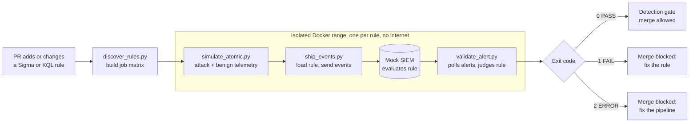

# Detection Validation Pipeline


**Detection-as-code with a real test step.** When a Sigma or KQL rule is added or changed, CI replays telemetry modeled on the rule's mapped Atomic Red Team test through a mock SIEM, then blocks the merge unless the rule fires on the attack and stays quiet on normal activity.

A rule that parses isn't necessarily a rule that works. Syntax linters can't tell you that a rule misses the abbreviated `-e` flag attackers really use, or that it also fires on every `-ExecutionPolicy`. This pipeline catches both.

## How it works



A rule passes only if all three checks hold for that specific run:

| Check | Catches |
| --- | --- |
| **Technique mapping** | A rule tagged with a different ATT&CK technique than its test exercises |
| **True positive** | A rule too narrow to fire on the attack |
| **No false positive** | A rule so broad it fires on the benign baseline |

The result is a clear exit code, so a broken log pipeline is never mistaken for a bad rule:

| Exit | Verdict | Meaning | Who acts |
| --- | --- | --- | --- |
| `0` | PASS | The rule behaved as expected | Nobody |
| `1` | FAIL | The rule is wrong | Rule author |
| `2` | ERROR | No trustworthy verdict: telemetry missing, SIEM down, or a rule the engine can't evaluate | Pipeline owner or rule author |

## Example output

From the included `fail_too_broad.yml` negative control:

```text
Rule: Negative control: too broad (00000000-0000-4000-8000-000000000002)
Test: T1059.001 PowerShell Command Execution (a538de64-1c74-46ed-aa60-b995ed302598)
  [PASS] Technique mapping: test exercises T1059.001; rule declares ['T1059.001']
  [PASS] True positive: 1 alert(s) on 2 attack event(s) from 'PowerShell Command Execution'
  [FAIL] No false positive: 1 alert(s) on 4 benign event(s)
      matched: powershell.exe -ExecutionPolicy RemoteSigned -File C:\Ops\inventory.ps1
RESULT: FAIL
```

## Quick start

You need Python 3.9 or later. Docker is only needed for `make validate-docker`.

```bash
python3 -m venv .venv
```

```bash
source .venv/bin/activate
```

```bash
make setup
```

```bash
make test
```

```bash
make validate RULE=detections/kql/powershell_encoded_command.kql
```

```bash
make validate RULE=tests/fixtures/rules/fail_too_narrow.yml
```

The last command fails on purpose.

## Repository layout

```text
.github/workflows/detect-test.yml   CI: self-test, discover, validate (matrix), gate
detections/
  sigma/                            Sigma rules (*.yml, *.yaml)
  kql/                              KQL rules (*.kql)
simulation/catalog.yml              Atomic test telemetry and the benign baseline
scripts/
  discover_rules.py                 Selects changed rules, builds the job matrix
  simulate_atomic.py                Generates telemetry for a rule's mapped test
  ship_events.py                    Loads the rule and forwards events to the SIEM
  validate_alert.py                 Applies the pass criteria, returns the exit code
src/dvp/
  sigma_engine.py, kql_engine.py    Fail-closed rule evaluators
  rules.py, catalog.py              Rule and test loading
  siem.py, siem_server.py           Mock SIEM logic and REST API
tests/                              Unit tests, negative controls, end-to-end runs
docs/                               Architecture and implementation guide
Dockerfile, docker-compose.yml      Hardened, network-isolated test range
```

## Adding a rule

Every rule declares the Atomic test that proves it, by GUID because test numbers shift upstream.

**Sigma:** add a custom field.

```yaml
tags:
  - attack.t1059.001
x_atomic_test: a538de64-1c74-46ed-aa60-b995ed302598
```

**KQL:** add a comment header.

```kql
// @id: 9c3e1a72-5d08-4f6b-b1e7-40a8d2c6f915
// @title: PowerShell Launched With Encoded Command (Defender XDR)
// @techniques: T1059.001
// @atomic_test: a538de64-1c74-46ed-aa60-b995ed302598
DeviceProcessEvents
| where FileName in~ ("powershell.exe", "pwsh.exe")
```

If the test isn't in [simulation/catalog.yml](simulation/catalog.yml) yet, add it there too.

## Scope and limitations

This pipeline **simulates** telemetry: it never runs an attack. That makes it fast, safe, and free to run on every PR. It also sets a clear limit on what a PASS means:

- **A PASS proves the rule's logic is right for the modeled telemetry.** It doesn't prove a real sensor emits that telemetry in your environment. Moving to real execution is [Phase 2 of the guide](docs/IMPLEMENTATION_GUIDE.md#phase-2-real-execution-with-invoke-atomic).
- **The rule engines are subsets.** Sigma covers the common modifiers and conditions, with no aggregations or keyword searches. KQL covers single-table filters only. Anything unsupported returns exit `2`, never a guessed verdict.
- **Mock matching is approximate.** `has` approximates Kusto's term index, and regexes run on Python's engine rather than RE2.
- **Coverage is process creation only** (`DeviceProcessEvents` for KQL), with two Atomic tests in the catalog so far.

See [docs/ARCHITECTURE.md](docs/ARCHITECTURE.md) for the design decisions and threat model.
