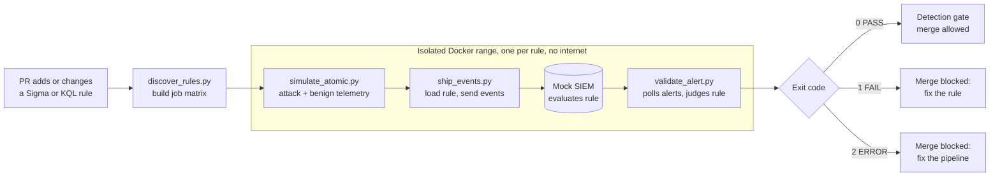

# Detection Validation Pipeline


**Detection-as-code with a real test step.** When a Sigma or KQL rule is added or changed, CI replays telemetry modeled on the rule's mapped Atomic Red Team test through a mock SIEM, then blocks the merge unless the rule fires on the attack and stays quiet on normal activity.

A rule that parses isn't necessarily a rule that works. Syntax linters can't tell you that a rule misses the abbreviated `-e` flag attackers really use, or that it also fires on every `-ExecutionPolicy`. This pipeline catches both.

## How it works



A rule passes only if all three checks hold for that specific run:

| Check | Catches |
| --- | --- |
| **Technique mapping** | A rule tagged with a different ATT&CK technique than its test exercises |
| **True positive** | A rule too narrow to fire on the attack |
| **No false positive** | A rule so broad it fires on the benign baseline |

The result is a clear exit code, so a broken log pipeline is never mistaken for a bad rule:

| Exit | Verdict | Meaning | Who acts |
| --- | --- | --- | --- |
| `0` | PASS | The rule behaved as expected | Nobody |
| `1` | FAIL | The rule is wrong | Rule author |
| `2` | ERROR | No trustworthy verdict: telemetry missing, SIEM down, or a rule the engine can't evaluate | Pipeline owner or rule author |

## Example output

From the included `fail_too_broad.yml` negative control:

```text
Rule: Negative control: too broad (00000000-0000-4000-8000-000000000002)
Test: T1059.001 PowerShell Command Execution (a538de64-1c74-46ed-aa60-b995ed302598)
  [PASS] Technique mapping: test exercises T1059.001; rule declares ['T1059.001']
  [PASS] True positive: 1 alert(s) on 2 attack event(s) from 'PowerShell Command Execution'
  [FAIL] No false positive: 1 alert(s) on 4 benign event(s)
      matched: powershell.exe -ExecutionPolicy RemoteSigned -File C:\Ops\inventory.ps1
RESULT: FAIL
```

## Quick start

You need Python 3.9 or later. Docker is only needed for `make validate-docker`.

```bash
python3 -m venv .venv
```

```bash
source .venv/bin/activate
```

```bash
make setup
```

```bash
make test
```

```bash
make validate RULE=detections/kql/powershell_encoded_command.kql
```

```bash
make validate RULE=tests/fixtures/rules/fail_too_narrow.yml
```

The last command fails on purpose.

## Repository layout

```text
.github/workflows/detect-test.yml   CI: self-test, discover, validate (matrix), gate
detections/
  sigma/                            Sigma rules (*.yml, *.yaml)
  kql/                              KQL rules (*.kql)
game/                               FakeQuest, its test tool, the license server, and the abuse scenarios
simulation/catalog.yml              Test telemetry and the benign baseline
telemetry/sysmon-config.xml         Sysmon configuration for real runs
scripts/
  discover_rules.py                 Selects changed rules, builds the job matrix
  simulate_atomic.py                Generates telemetry for a rule's mapped test
  collect_real_telemetry.py         Runs a test on Windows and labels the real Sysmon logs
  ship_events.py                    Loads the rule and forwards events to the SIEM
  validate_alert.py                 Applies the pass criteria, returns the exit code
src/dvp/
  sigma_engine.py, kql_engine.py    Fail-closed rule evaluators
  rules.py, catalog.py              Rule and test loading
  siem.py, siem_server.py           Mock SIEM logic and REST API
tests/                              Unit tests, negative controls, end-to-end runs
docs/                               Architecture and implementation guide
Dockerfile, docker-compose.yml      Hardened, network-isolated test range
```

## Adding a rule

Every rule declares the Atomic test that proves it, by GUID because test numbers shift upstream.

**Sigma:** add a custom field.

```yaml
tags:
  - attack.t1059.001
x_atomic_test: a538de64-1c74-46ed-aa60-b995ed302598
```

**KQL:** add a comment header.

```kql
// @id: 9c3e1a72-5d08-4f6b-b1e7-40a8d2c6f915
// @title: PowerShell Launched With Encoded Command (Defender XDR)
// @techniques: T1059.001
// @atomic_test: a538de64-1c74-46ed-aa60-b995ed302598
DeviceProcessEvents
| where FileName in~ ("powershell.exe", "pwsh.exe")
```

**Game rules:** use `x_game_test` with the name of a test in the catalog, and add a matching script to `game/scenarios/`.

If the test isn't in [simulation/catalog.yml](simulation/catalog.yml) yet, add it there too.

## Simulated and real telemetry

The pipeline tests rules against two kinds of telemetry:

| | Simulated | Real |
| --- | --- | --- |
| **Workflow** | `detect-test.yml` | `real-telemetry.yml` |
| **Runs on** | Every PR | Pushes to `main`, `telemetry/**` branches, and manual runs |
| **Telemetry** | Events modeled on each Atomic test | Sysmon logs from running the test with `Invoke-AtomicTest` on a disposable Windows VM |
| **Purpose** | Fast, safe merge gate | Evidence that the rules work on what Windows actually logs |

Real tests never run on PRs, because code from a PR must not choose what gets executed. Each real run keeps its raw Sysmon logs as a downloadable artifact.

Real machines are noisy, so events are labeled by process tree instead of by time: only the process running the test's own command, and its children, count as attack events. Benign commands from the baseline run for real as well.

Real logs have already changed this project. The exported Sysmon logs showed `%VAR%` as `%%VAR%%` in a command line, so the simulated events now match what Windows logged.

## Game security detections

Real game tampering is the project's niche. These rules protect [FakeQuest](game/), a harmless stand-in game with a pretend license check, so nothing here touches a real game or real anti-cheat software.

| Threat | Rule watches for | Sysmon event | ATT&CK |
| --- | --- | --- | --- |
| **License bypass** | A command writing a license server entry to the `hosts` file | Process creation | T1565.001 |
| **Mod or crack injection** | The game loading a system-named DLL from outside the Windows folder | DLL load | T1574.001 |
| **Memory tampering** | A process requesting write access to the game's memory | Process access | T1055 |
| **Bootleg copy** | FakeQuest running with a hash that isn't on the official list | Process creation | T1554 |

The tests are harmless on purpose. The license domain uses the reserved `.invalid` name, the planted DLL is an unmodified signed Windows file, the memory tool closes its handle without reading or writing anything, and the bootleg copy only has one word changed in its startup message. **This project detects tampering, so it doesn't include cracks, cheats, or bypass techniques.**

ATT&CK describes attacks on organizations, so a player tampering with their own copy of a game only partly fits. Each rule keeps the closest technique and adds its own `x_game_threat` label.

### License server abuse

Some abuse only shows up as a pattern, so these rules count activity over time using standard [Sigma correlations](https://sigmahq.io/docs/meta/correlations.html). Their logs come from [a small license server](game/license_server.py) that only listens on the local machine, with demo keys that unlock nothing. It logs keys as hashes, so the logs don't hold working keys.

| Threat | Rule watches for | Must ignore | ATT&CK |
| --- | --- | --- | --- |
| **Key guessing** | 10 or more different unknown keys from one address in 5 minutes | A player retrying the same mistyped key | T1110 |
| **Key sharing** | One key used on 3 or more machines in an hour, with 2 seats allowed | A player reinstalling on their two PCs | T1078 |

Both rules count different values, not attempts. Two negative controls show why: the same rules counting attempts fire on those normal players, and the pipeline fails them.

## Roadmap

1. ~~Validate rules against simulated attacks in CI~~
2. ~~Validate against real Windows logs, and add game tampering rules~~
3. ~~Detect license server abuse by counting events over time~~
4. ~~Spot bootleg copies: game builds that don't match the official release~~
5. **Evasion testing:** try harmless variations of each attack, and score which ones get past each rule
6. **False-positive testing:** measure each rule's noise against realistic normal activity
7. **Real SIEM:** run the rules in a real SIEM as well as the mock
8. **Public dashboard:** publish coverage, the latest results, and known gaps

## Scope and limitations

- **License traffic is scripted.** The server and its logs are real, but the requests come from test scripts on one machine, so every request has the same address. Real thresholds need tuning against real player traffic, and an attacker spreading guesses across many addresses wouldn't trigger the guessing rule.
- **Coverage is small.** The catalog has two Atomic tests, four game tests, and two license tests, and KQL rules can only use `DeviceProcessEvents`.
- **The bootleg rule goes by file name.** It only checks files named `FakeQuest.exe`, so a renamed copy gets past it. Hashes also only help when the official list is complete, so a missing patch would look like a bootleg.
- **Game rules are tied to FakeQuest.** Protecting a real game means changing the game name in each rule, and the access values and DLL names need tuning for that game.
- **A real pass applies to one environment.** It covers a clean Windows Server VM with a minimal Sysmon configuration, not every Windows setup, and it doesn't measure false positives on real user activity.
- **The rule engines are subsets.** Sigma covers the common modifiers, conditions, and `expand` placeholders, plus `event_count` and `value_count` correlations, with no keyword searches. KQL covers single-table filters only. Anything unsupported returns exit `2`, never a guessed verdict.
- **Mock matching is approximate.** `has` approximates Kusto's term index, and regexes run on Python's engine rather than RE2.

See [docs/ARCHITECTURE.md](docs/ARCHITECTURE.md) for the design decisions and threat model.
