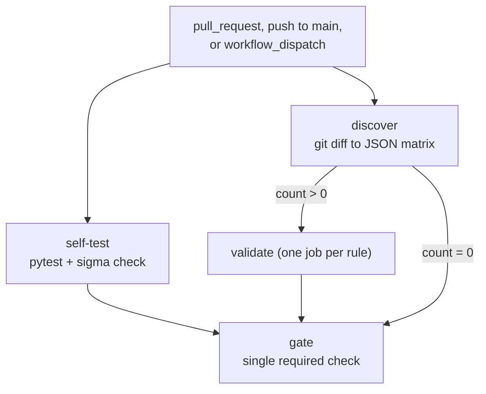
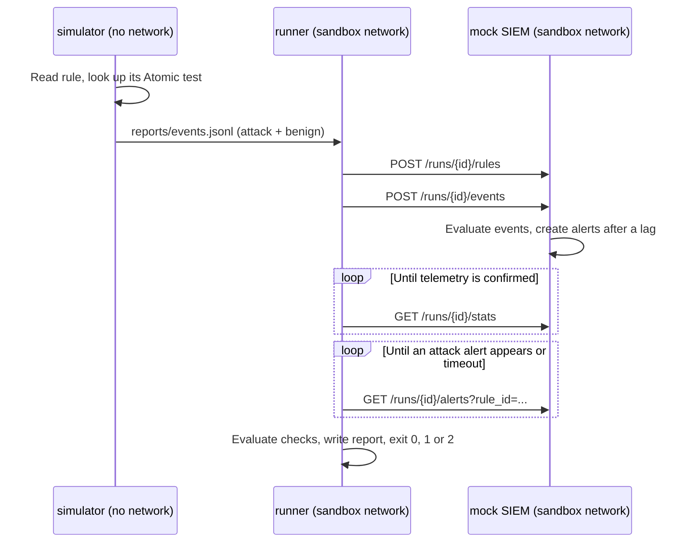

# Architecture

## Goal

Treat detections like code: each rule ships with an executable test, and a rule that fails its test can't merge.

## CI flow

## Validation sequence

## Design decisions

| Decision | Why | Trade-off |
| --- | --- | --- |
| **Simulated telemetry first** | Runs on every PR in seconds, with nothing dangerous to contain | Doesn't prove a real sensor produces the telemetry |
| **Real telemetry outside PRs** | Real logs catch what simulation can't, but executing tests must not be controllable from a PR | Real results arrive after a push, so they aren't a merge gate |
| **Standard Sigma correlations, counted per scenario** | Rules stay portable to other Sigma tools, and benign events can't complete an attack's count | A real SIEM has no scenario labels, so mixed traffic behaves differently there |
| **Tests on a fake game of the project's own** | Keeps the project clear of real cracks, cheats, and game licenses, and lets anyone run it | Rules need tuning before protecting a real game |
| **Label real events by process tree** | Machines are noisy, and helper processes log first, so a time window would mislabel events | Only tests that start processes fit this approach so far |
| **Telemetry modeled on the Atomic test, not the rule** | Telemetry fitted to the rule would make every test pass. `upstream_command` and a unit test anchor the catalog to the real test | Adding a test means modeling its events by hand |
| **Benign baseline in every run** | True positives alone reward overbroad rules | The baseline needs to grow to stay useful |
| **Separate FAIL (1) and ERROR (2)** | Otherwise an outage looks like a bad rule, and people learn to distrust the gate | Slightly more code paths |
| **Telemetry check before judging** | Zero alerts means nothing if zero events arrived. A missing benign set would make the false-positive check pass vacuously | None worth noting |
| **Fail-closed engines** | Skipping an unsupported clause changes the rule's meaning and can produce a false PASS | Rules outside the subset can't be validated until the engine grows |
| **Run IDs scope everything** | Stale alerts can't satisfy a new run | None worth noting |
| **Atomic test GUIDs, not numbers** | Upstream test numbers shift when tests are added or removed | Less readable, so rules also carry the technique |
| **Negative controls in the test suite** | They prove the validator can actually say no | More fixtures to maintain |
| **A stable `gate` job** | Matrix job names vary by rule, so branch protection can't require them directly | One extra job |
| **No path filter on PRs** | A required check that never starts leaves the PR stuck on "pending" | The self-test also runs on docs-only PRs |

## Threat model

The rule under test is **untrusted input**: anyone can open a PR on a public repo.

| Threat | Mitigation |
| --- | --- |
| Script injection through filenames or event fields | Values reach the shell through `env:`, never inline `${{ }}`. `discover_rules.py` rejects unusual path characters |
| A stolen or abused token | `permissions: contents: read`. Workflows use `pull_request`, never `pull_request_target`, so forks get no secrets |
| A compromised or retagged action | Actions are pinned to full commit SHAs |
| Malicious YAML | `yaml.safe_load` only |
| Regex denial of service from a crafted rule | Container memory and PID limits, plus job `timeout-minutes` |
| Exfiltration from the test range | The `sandbox` network is `internal`, the simulator has no network, and no ports are published |
| Container breakout | Non-root user, read-only root filesystem, all capabilities dropped, `no-new-privileges` |
| A PR that edits the pipeline itself | A PR can change the workflow, Dockerfile, or validator, so a green check alone doesn't clear it. Protect those paths with CODEOWNERS. GitHub's fork restrictions limit the blast radius |

`real-telemetry.yml` executes Atomic tests for real, so it runs only on GitHub-hosted disposable VMs and is never triggered by pull requests.

**Never attach a self-hosted runner to this repo while it's public.** A fork PR could run arbitrary code on that machine, which matters most once Phase 2 runs real techniques.

## Extension points

- **Real SIEM:** implement `stats()` and `alerts()` in a new source class alongside `ApiSource` in `validate_alert.py`. The evaluation logic doesn't change.
- **Other telemetry sources:** produce the same JSONL event format, as `collect_real_telemetry.py` does for Sysmon, and the later stages stay the same.
- **New techniques:** add an entry to `simulation/catalog.yml`, plus a script in `game/scenarios/` for a game test.
- **New log sources:** add a table mapping in `kql_engine.py` and the matching category in the catalog.
